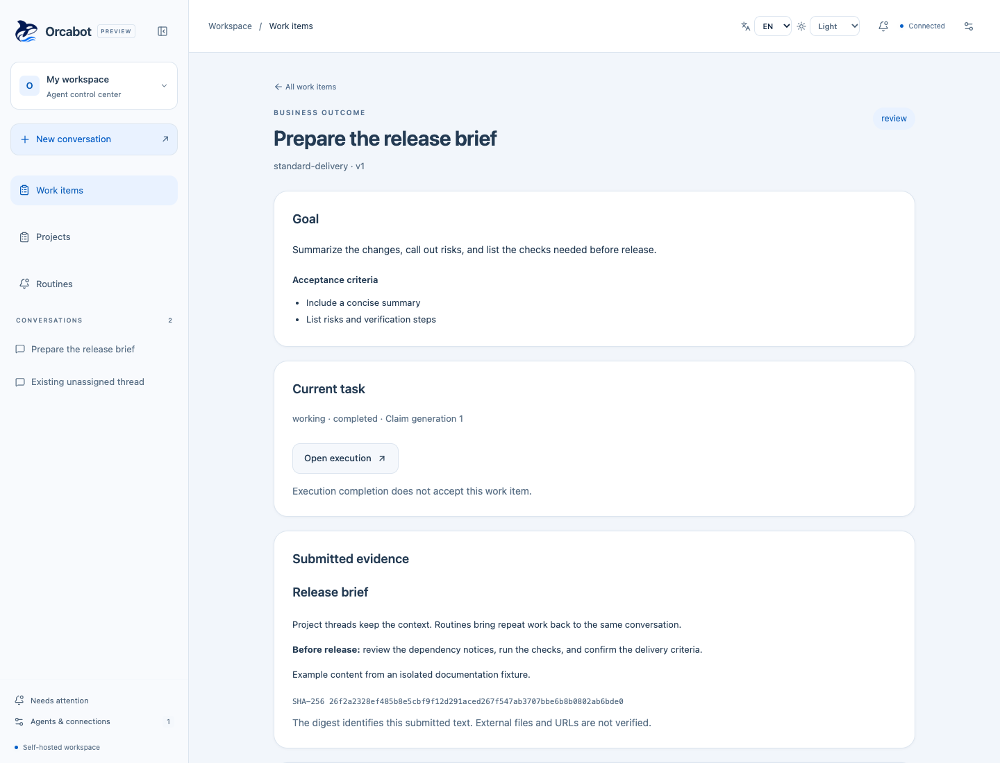
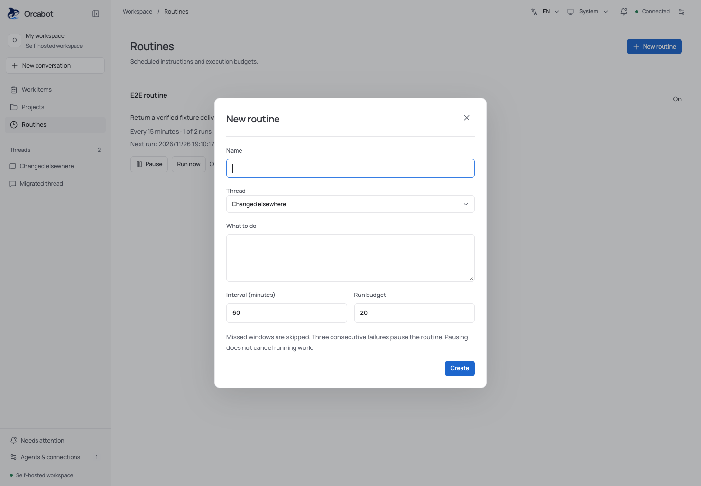

<p align="center">
  <picture>
    <source media="(prefers-color-scheme: dark)" srcset="apps/web/public/brand/orca-dark.png" />
    
  </picture>
</p>

<h1 align="center">Orcabot</h1>
<p align="center"><strong>Turn AI conversations into reviewed work.</strong></p>
<p align="center">A self-hosted AI workbench for tasks, threads, and routines.<br />Keep the goal, run work on the right machine, and review what comes back.</p>

<p align="center">
  <a href="#try-orcabot">Try Orcabot</a> ·
  <a href="docs/en/README.md">Read the docs</a> ·
  <a href="https://github.com/orcabot-ai/orcabot/issues">Share feedback</a> ·
  <a href="README.zh-CN.md">简体中文</a>
</p>
<p align="center">
  <a href="https://github.com/orcabot-ai/orcabot/actions/workflows/ci.yml"></a>
  · Early preview · Self-hosted · <a href="LICENSE">MIT</a>
</p>

<picture>
  <source media="(prefers-color-scheme: dark)" srcset="docs/screenshots/readme-work-dark.png" />
  
</picture>

_Actual Orcabot UI with example data from an isolated fixture. No paid model calls._

## Less checking in. More work you can review.

For builders and operators running AI work across local and remote machines,
Orcabot keeps the conversation connected to the task and its result. Return to a
thread, see what happened, and decide what needs your attention next.

| What you want              | How Orcabot helps                                                                                                                             |
| -------------------------- | --------------------------------------------------------------------------------------------------------------------------------------------- |
| Pick up where you left off | Persistent project threads keep conversations and execution history together. Rename, organize, or archive without losing past runs.          |
| Know what is ready         | Task boards put goals, acceptance criteria, submitted evidence, and review decisions in one place.                                            |
| Repeat useful work         | Routines run an instruction on a fixed interval and return results to the same thread, with an execution budget and automatic failure pauses. |
| Work across machines       | Connect local or remote execution targets. Start the worker where you need it and use a browser to access it.                                 |
| Use your own tools         | CLI and SDK commands support headless workflows alongside the web UI.                                                                         |

English and Simplified Chinese. Light, dark, and system themes. A responsive web UI
built with React, Tailwind CSS, and TanStack.

## From a goal to a reviewed result

1. **Set the goal.** Create a work item with clear acceptance criteria and select
   an Agent configured for the execution machine.
2. **Run the work.** Follow the conversation, streamed progress, and requests for
   input. Keep the original execution history when you return.
3. **Review the evidence.** Submit a deliverable, check it against the criteria,
   then approve it or request correction.

Execution completion and business acceptance are separate. A successful run still
needs evidence and a review decision before the work item is accepted.

## Put repeat work on a routine

Bind a standing instruction to an existing thread, choose an interval and a run
budget, then read the results in that thread. Pause, resume, or run it now from the
UI or CLI. Missed windows are skipped; three consecutive confirmed failures pause
the routine. Unknown outcomes pause immediately for investigation.

<details>
<summary>See the routine editor</summary>

<picture>
  <source media="(prefers-color-scheme: dark)" srcset="docs/screenshots/routine-dark.png" />
  
</picture>

[Projects, threads, and routine behavior](docs/en/threads-and-routines.md)

</details>

## Try Orcabot

The preview runs from source. Requires **Node.js 24 or 26**, **pnpm 11.25.0**, and
provider credentials for your chosen execution harness. First local startup needs
network access, npm, and a supported current-user service manager.

**1. Build and start the worker.**

```sh
git clone https://github.com/orcabot-ai/orcabot.git
cd orcabot
pnpm install --frozen-lockfile
pnpm build
pnpm start worker run
```

**2. Open the web client in another terminal.**

```sh
pnpm start web run
```

**3. Open [localhost:4320](http://127.0.0.1:4320)** and enter the service key printed
by the worker. Configure an execution target and Agent, prepare its working
directory on the execution machine, then create your first conversation or work item.

Orcabot automatically prepares local execution through OctoRuntime. Provider login
is still required; model-provider charges depend on your account. Keep the service
key and worker stdout private. Set `ORCABOT_TOKEN` to preserve the key across
restarts. The API listens on `127.0.0.1:4310` by default.

<details>
<summary>Connect a remote worker or run headless commands</summary>

```sh
# Controller with remote execution targets only:
pnpm start worker run --execution remote

# Browser host connected to a worker on another machine:
pnpm start web run --worker-url https://worker.example.com

# Explore the CLI and inspect work:
pnpm start --help
pnpm start version
pnpm board list --json
pnpm start routine list --json
```

An installed/linked CLI uses `orcabot` in place of `pnpm start`. Set `ORCABOT_URL`
and `ORCABOT_TOKEN` for authenticated headless commands. `.env.example` is a
reference; it is not automatically loaded.

[CLI, configuration, and deployment](docs/en/cli-and-deployment.md)

</details>

## What is ready, and what comes next

**Available:** persistent conversations and project threads; streamed execution,
input requests, and cancellation; task delivery and human review; bounded interval
routines; local/remote execution; browser UI, CLI, and SDK; SQLite persistence and
recovery tied to the original execution identity.

**Planned:** perception connectors, autonomous coordination, broader workflow
customization, Git worktrees, cron/timezone schedules, A2UI, and Electron/DMG.
These are roadmap items, not available features. See the
[product direction](docs/en/product-direction.md) and
[current implementation boundaries](docs/en/threads-and-routines.md).

This early preview uses one shared operator key/session. Independent users, scoped
Agent credentials, and independent reviewer guarantees are not implemented. Use a
trusted network or HTTPS ingress for remote access. SQLite contains private
conversations and configuration secrets. See [security](SECURITY.md) and
[validation and limitations](docs/en/validation.md).

## Build with us

Try a real task and tell us where the flow breaks. [Report a bug or suggest a feature](https://github.com/orcabot-ai/orcabot/issues).
For code contributions, start with [CONTRIBUTING](CONTRIBUTING.md).

```sh
pnpm dev
pnpm check
pnpm format:check
pnpm e2e
# After dependency changes:
pnpm licenses:report
```

Vite development uses port 5173 and needs
`ORCABOT_PUBLIC_URL=http://127.0.0.1:5173`; `ORCABOT_EXECUTION=remote` skips local
execution preparation. See [architecture](docs/en/architecture.md) for the pnpm
workspace layout and [deployment](docs/en/cli-and-deployment.md) for production.

## License

Original Orcabot code, documentation, and supplied project assets are [MIT](LICENSE).
Imported OctoRuntime portions retain Apache-2.0. Dependencies retain their own
licenses; see [THIRD_PARTY_NOTICES](THIRD_PARTY_NOTICES.md), the reproducible
[dependency inventory](licenses/dependencies.json), and [licensing guide](docs/en/licensing.md).
