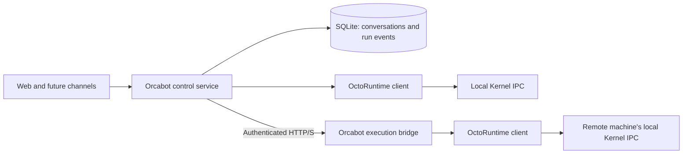

# Architecture

## Package boundaries

- `apps/server`: Node HTTP service and startup CLI; serves the built web UI.
- `apps/web`: TanStack Start/Router/Query/Form/Table/Virtual with React/Tailwind; no Runtime credentials or harness code.
- `packages/orcabot-contracts`: runtime-validated application contracts and event projections.
- `packages/orcabot-store`: versioned SQLite persistence and append-only event cursors.
- `packages/orcabot-runtime`: public OctoRuntime client integration and remote bridge client.
- `packages/orcabot-workflows`: pure configurable transition validation, independent of UI and Runtime.
- `packages/orcabot-cross-service`: imported native user-service lifecycle backends; independent of runtime transport and not yet exposed by the CLI.

The control service owns one authoritative workspace. A remote service retains
its own execution record for idempotency and event replay, not a synchronized copy
of the control database. Browsers read projections; they are not event authorities.

## Run lifecycle

Orcabot execution status is `running`, `waiting`, `completed`, `failed`,
`cancelled` or `unknown`. `waiting` means an unresolved canonical interaction.
Runtime terminal events establish completed/failed/cancelled. A local admission
rejected before submission can also be recorded as failed; it is never retried
automatically. A transport
failure or missing terminal becomes unknown. A cancellation response acknowledges
a request; the terminal stream determines the result. Controls never turn a Run
into completed. Observation recovery never retries business work.

Conversation turns capture an Agent snapshot. A new turn cannot begin while the
previous turn is running, waiting or unknown. An unknown execution must be
reconnected to its original execution or investigated on its host. Recovery may
move an unknown run back to running; only subsequent Runtime events can establish
an execution result. The attention view records revision-checked investigation
notes without changing outcomes or suppressing pending approvals. Provider session updates
are saved transactionally with their event. A browser disconnect only unsubscribes.

## API outline

All `/api` routes except the session exchange require a service key or session cookie.
Mutating browser requests are same-origin. The web UI and API share one origin.

- `POST /api/session`: exchange a key for a session cookie.
- `GET /api/state`: bounded configuration and recent conversation summaries.
- `POST /api/targets`, `POST /api/agents`, `POST /api/conversations`.
- `GET /api/conversations/:id`: read a conversation without provider continuation data.
- `GET /api/conversations/:id/runs?before=...`: page run history.
- `POST /api/conversations/:id/runs`: create a turn and return immediately.
- `GET /api/runs/:id/event-page?after=...`: bounded event history.
- `GET /api/runs/:id/events?after=...`: replay/tail durable events using SSE.
- `POST /api/runs/:id/cancel`, `POST /api/runs/:id/respond`.
- `POST /api/runs/:id/recover`: resume observation of the saved execution.
- `GET /api/attention?before=...`, `POST /api/runs/:id/review`.
- `GET /api/runs/:id/artifacts?before=...`, `POST /api/runs/:id/artifacts`.
- `PUT /api/executions/:id`: bridge admission with a caller-selected idempotency identity.
- `GET /api/executions/:id`, `GET /events`, `POST /recover`, `POST /cancel`, `POST /respond`: bridge observation/control.

Never automatically follow remote redirect responses carrying a key. Reject
non-HTTP URLs and embedded credentials. The bridge caller has privileged network
and execution access; use trusted targets and a protected network.

## Acceptance boundary

M0 proves transport, persistence and web interaction using deterministic test
harnesses as well as a real public-client/Kernel IPC test where available. Provider
credentials and live model execution are an operator integration check, not faked
by displaying mock success in the application. The server reports an unavailable
Kernel without pretending execution succeeded.

Browser projections remove private reasoning content and provider continuation
payloads. Bridge event streams are privileged server-to-server records and retain
continuations so the control service can persist and reuse them. Tool output and
conversation text remain visible to the trusted operator.

## Durable observation and web presentation

SQLite schema v2 added private target/checkpoint snapshots, append-only investigation
notes and artifact metadata while retaining existing history. Canonical event and
upstream cursor updates are atomic. Recovery queries the original local identity
on its expected Kernel instance or the original remote bridge run. Upstream
cursors and Orcabot event sequences remain distinct. Startup and manual recovery
share the admission capacity; closing the service releases observation only.
See [the recovery contract](operational-continuity.md).

[The TanStack frontend](frontend.md) uses a prerendered, credential-free Start SPA
shell served by Fastify. Router owns conversation URLs, Query owns cached API
state, Form handles operator inputs, Table presents attention records and Virtual
bounds mounted conversation rows. Semantic CSS themes cover light, dark and
system appearance. Shell bootstrap scripts receive exact CSP hashes. Public
application data remains in the API/SQLite boundary rather than browser replication.

## Proposed coordination expansion

The [Board-inspired dimension plan](board-dimensions.md) describes the proposed
coordination, activation, connector and business-delivery boundaries. Its records
and commands are planned extensions; the API and schema above describe the
current execution workbench.

## P1 business delivery

SQLite schema v3 adds scoped channel/workflow records, business work items, tasks,
private command receipts, immutable submitted text evidence and thread events.
A task's original Run/request/checkpoint is its persisted dispatch intent. That
intent and task link commit together, then observation starts; a restart never
silently starts a replacement. Nested store operations use savepoints.

Business workflow state, coordination status and Runtime outcome are separate.
Configured review transitions require an operator decision for the exact current
evidence and WorkItem revision. The existing shared key remains one trusted
principal; actor labels do not create independent permissions. The web UI, JSON
worker CLI and `orcabot-client` share the authenticated command API.

See [P1 delivery](p1-delivery.md) for its complete bounded contract and remaining
scope. The older ten-dimension plan remains the target architecture for later
activation, connector and identity work.
