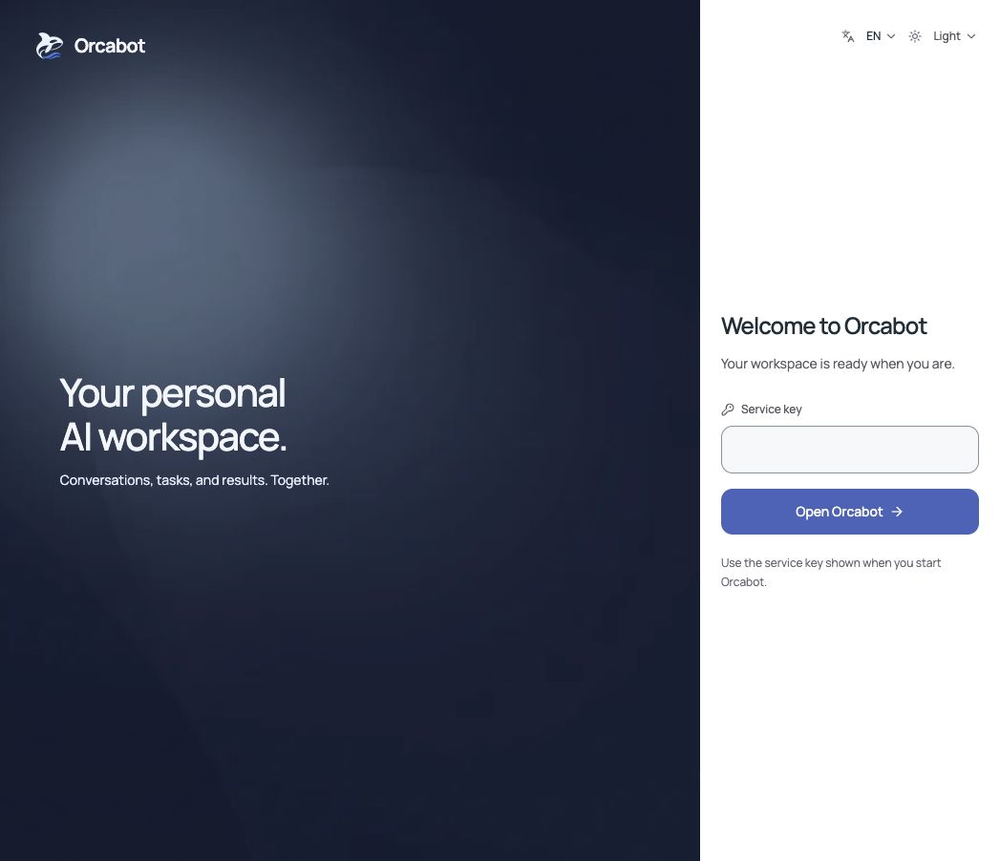

# Personal AI sign-in

[简体中文](README.zh-CN.md)

The login now uses a quiet ink-blue background and direct personal-AI copy. It fills the viewport: 70% visual identity, 30% real sign-in on desktop, with a compact brand header on phones. The supplied logo stays small. There is no outer margin, enclosing rounded frame, floating icon badge, particle canvas, or task demonstration.

## Image provenance

The local `ai-atmosphere-768.webp` and `ai-atmosphere-1536.webp` assets were generated in [Gemini](https://gemini.google.com/app/b80018c42d07b266) on November 27, 2026, then resized and encoded as WebP. The [exact prompt](prompt.txt) is retained; matching metadata sidecars accompany both images. The background is decorative, has empty alternative text, and makes no external requests at runtime. Product copy and authentication remain HTML. The generated image is a backdrop, not a UI mockup.

The previous detailed ocean scene was rejected as too ornamental for an AI product and is not included in the shipped assets.

## Reference scope

Research started with the Product Hunt listings for [Lindy](https://www.producthunt.com/products/lindy) and [Gumloop](https://www.producthunt.com/products/gumloop), followed by their actual [Lindy sign-in](https://chat.lindy.ai/login) and [Gumloop site](https://www.gumloop.com/). The useful references were restrained brand atmosphere and a clear sign-in hierarchy. The 70/30 composition is an Orcabot owner requirement, not a claimed reproduction of either product.

## Verification

The browser checks cover 1440px and 964px desktop layouts, 390px and 320px phone layouts, both languages and themes, appearance/language persistence, full-viewport bounds, no document scrolling, image loading, invalid-key recovery and protected deep links. Short windows keep scrolling inside the form region. Both images must be present in the packaged CLI web bundle.

Screenshots in `captures/` include authenticated entry, locked sign-in, mobile and an invalid-key state. Only the isolated E2E fixture uses the test key shown as masked input. No real service keys are stored in these captures.

Validation completed: `pnpm check` passed (154 tests passed, 22 platform skips, zero failures), full `pnpm e2e` passed, and `pnpm format:check` passed. A fresh independent finish reviewer inspected all eight required captures and returned `ship`; the code verdict was `approve`, with no P0/P1/P2 findings. The design detector reported only an existing monospace declaration outside the login scope.
