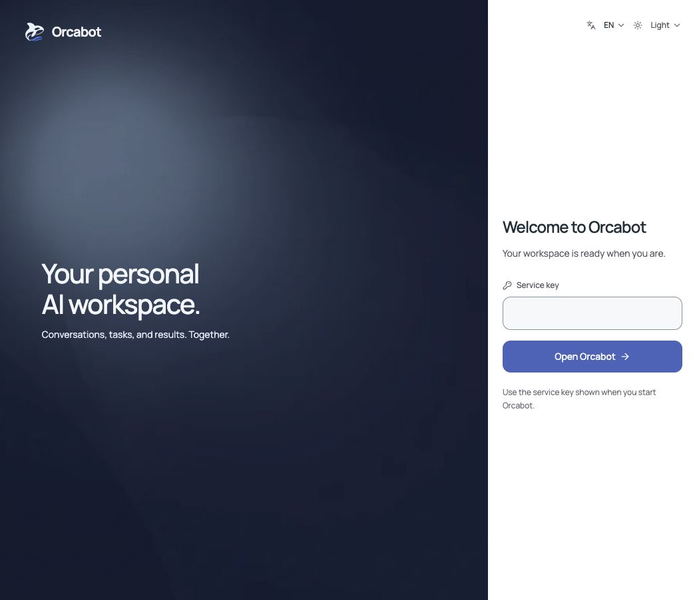

# 个人 AI 登录入口

[English](README.md)

登录页使用低对比深蓝背景和明确的个人 AI 文案。桌面保持左侧视觉 70%、右侧真实登录 30%，贴边铺满；手机缩为紧凑品牌头部。原版 Logo 保持小尺寸。移除外侧留白、包围整页的圆角框、悬浮图标、粒子 Canvas 和任务演示。

## 图片来源

本地 `ai-atmosphere-768.webp` 和 `ai-atmosphere-1536.webp` 于 2026 年 11 月 27 日通过 [Gemini](https://gemini.google.com/app/b80018c42d07b266) 生成，再缩放压缩成 WebP。[完整提示词](prompt.txt)和图片元数据文件均保留。图片只作装饰背景，替代文本为空；运行时无需外部图片请求。文案与登录仍是真实 HTML。它是背景，并非把生成的界面截图当作网页。

此前细节繁多的海洋插画被认为不符合 AI 产品定位，未包含在最终资源中。

## 参考范围

从 Product Hunt 的 [Lindy](https://www.producthunt.com/products/lindy) 和 [Gumloop](https://www.producthunt.com/products/gumloop) 条目找到产品，再查看真实登录界面。参考的是品牌氛围和清晰的表单层级。7:3 比例来自 Orcabot 的产品要求，并非声称这两个产品采用相同布局。

## 验证

浏览器检查覆盖 1440／964 桌面宽度、390／320 手机宽度，中英文与深浅色、偏好保存、满屏边界、无页面滚动、图片加载、错误密钥重试和受保护链接恢复。矮窗口只允许表单内部滚动。发布包验证必须包含两种尺寸的背景图。

`captures/` 保存已授权入口、待登录、手机及错误密钥状态。截图中的掩码密钥来自隔离 E2E 测试，不包含真实服务密钥。

验证完成：`pnpm check` 通过，154 项测试通过、22 项平台相关跳过、零失败；完整 `pnpm e2e` 和格式检查通过。独立审阅检查了八张必要截图，设计结论为 `ship`，代码结论为 `approve`，没有 P0／P1／P2 问题。设计检测仅报告登录范围之外已有的等宽字体声明。
