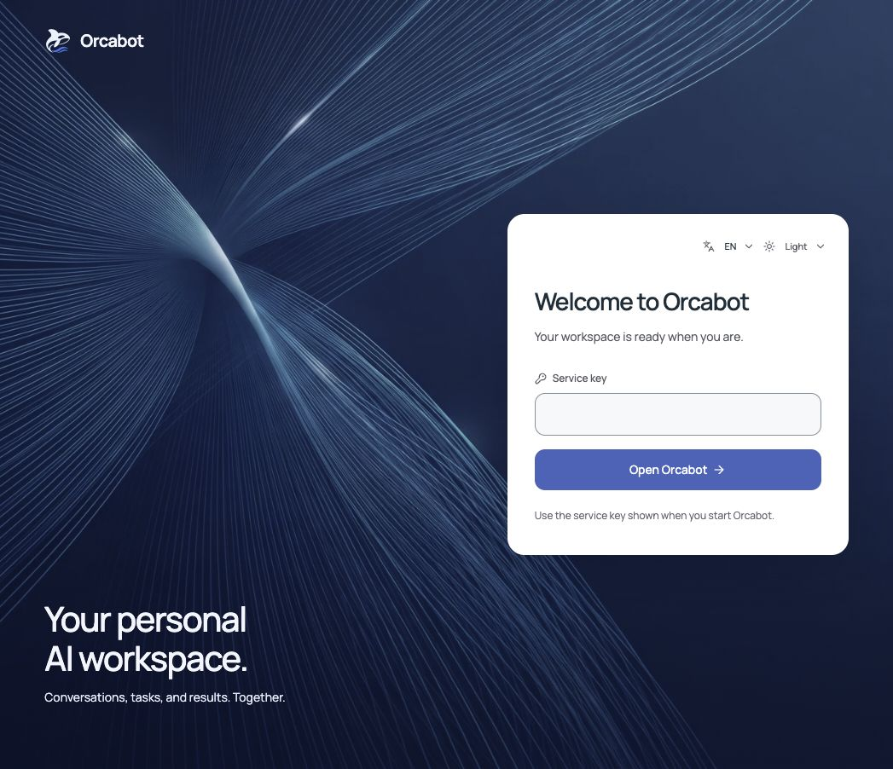

# Full-background sign-in

[简体中文](README.zh-CN.md)

The owner approved the standalone blue-filament poster and the full-screen background with a floating right sign-in panel. This replaces the earlier hard 70/30 split. The actual login controls, small supplied logo and bilingual copy remain HTML.

## Artwork

[Gemini source](https://gemini.google.com/app/bde306223c430e20). The original poster and clean background live in `output/artwork/orcabot-poster/`. Shipping assets are local `ai-flow-960.webp` and `ai-flow-1920.webp`; matching sidecars record the exact prompt and source. No external generation or image request is needed at runtime. The background is decorative with empty alternative text.

## Behavior

A 400px solid panel sits inset from the desktop edges. It uses existing theme colors, 20px corners and a restrained shadow. At 850px and below it centers beneath the brand; secondary copy is hidden. Short screens scroll inside the form, while preferences remain available. The document stays one viewport.

Validation covers desktop 1440/964, phone 390/320, short landscape 844x390 and 320x480, both themes and languages, saved preferences, image loading/decoding, invalid-key retry and protected deep-link recovery. Packaged web verification requires both artwork variants.

Build, full E2E and formatting passed. A fresh independent reviewer inspected all nine required captures and returned `ship`; the independent code verdict was `approve` with no P0/P1/P2 findings. The design detector reported only an existing monospace declaration outside this change.
