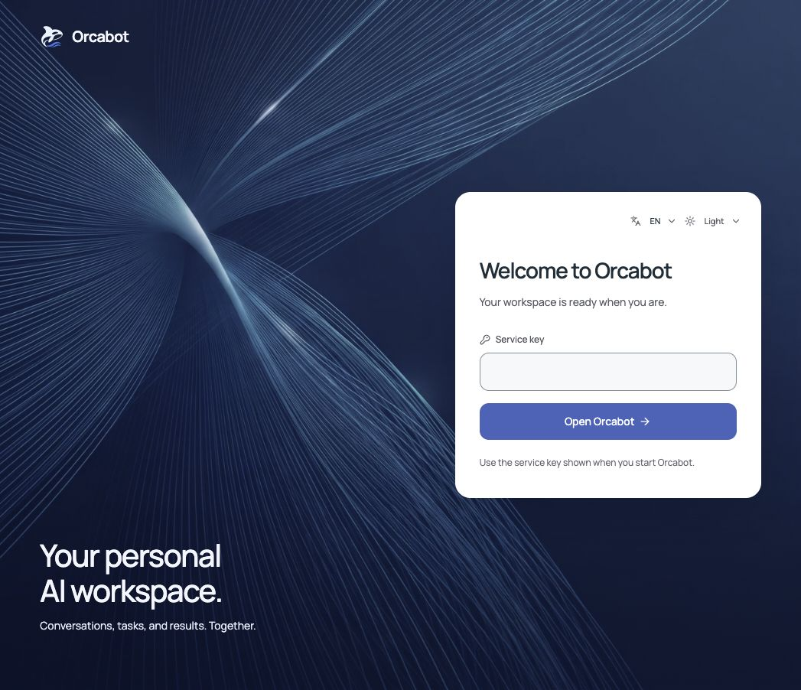

# 全屏背景与悬浮登录

[English](README.md)

使用已确认的独立蓝色光流海报作为底图，右侧放置悬浮登录面板，替换此前硬切的7:3布局。登录控件、小尺寸原版Logo和双语文案均保持HTML。

[Gemini来源](https://gemini.google.com/app/bde306223c430e20)。原始海报和无字背景保存在`output/artwork/orcabot-poster/`；应用使用本地960和1920宽WebP，并记录完整提示词。运行时不访问外部图片服务。

桌面面板宽400px，采用主题实体底色、20px圆角和轻阴影，与屏幕边缘保持间距。850px及以下在品牌下方居中，隐藏次要文案；矮屏只滚动表单，页面保持单屏。

验证覆盖桌面1440/964、手机390/320、横屏844x390和短屏320x480，中英文、深浅色、偏好保持、图片解码、错误密钥重试、受保护链接恢复。发布包必须包含两种图片尺寸。

构建、完整E2E与格式检查通过。独立审阅检查九张必要截图，设计结论为`ship`，代码结论为`approve`，没有P0/P1/P2问题。设计检测只报告此次范围外已有的等宽字体声明。
