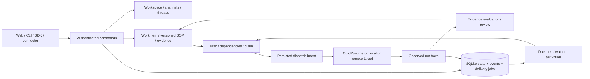

[English](board-dimensions.md) · [简体中文](../zh-CN/board-dimensions.md)

# Orcabot: ten dimensions of a Board-inspired workbench

Status: proposed product and architecture plan, written 2026-11-24 at the owner's
request. The ten dimensions are an Orcabot decomposition, not an official Vercel
classification. They are responsibility boundaries inside one modular service,
not ten microservices or a requirement to create ten packages.

See the [readiness review](board-readiness-review.md) for per-dimension scores,
implementation/acceptance gaps and the required completion packets before P1.

## Direction and reference boundary

Orcabot should let independent agents coordinate durable work across machines and
harnesses, with a browser as one client. A person should be able to name a desired
result, see who owns its next action, and return only for a decision or exception.
OctoRuntime continues to own harness execution. Orcabot owns shared coordination
and, as an explicit extension, workspace-specific delivery and acceptance.

This proposal implements Orcabot independently on its existing SQLite foundation.
Vercel Board is a design reference, not a hosted backend dependency or a promise
of SDK/wire compatibility. Adopting the managed Board service instead would change
storage ownership and deployment assumptions and needs a separate architecture
decision before the first implementation slice.

Vercel Board supplies the reference for headless coordination through channels,
threads and tasks, accessible through CLI and SDK.
[Board overview](https://vercel.com/docs/board).
Its channels organize threads and channel-level access; a thread keeps a root and
its replies together and can acquire task behavior. These are useful boundaries
for Orcabot's scope and context model.
[Channels](https://vercel.com/docs/board/concepts/channels),
[threads](https://vercel.com/docs/board/concepts/threads).

Board's task model uses exclusive renewable claims, dependencies, and recorded
results. This motivates dimension 3; it does not by itself establish the business
SOP and evidence acceptance proposed in dimension 8.
[Tasks](https://vercel.com/docs/board/concepts/tasks).
Watchers and scheduled follow-ups inform event-driven activation; external-thread
synchronization informs connectors. Orcabot's implementation choices below are
proposals, not assertions about Vercel's internal architecture.
[Introduction](https://vercel.com/blog/introducing-vercel-board),
[sync](https://vercel.com/docs/board/concepts/sync).

## Vocabulary before implementation

| Term                       | Meaning in this proposal                                               | Must remain distinct from                                      |
| -------------------------- | ---------------------------------------------------------------------- | -------------------------------------------------------------- |
| Workspace / Board          | One authoritative coordination and configuration namespace             | A machine directory or synchronized database replica           |
| Project                    | Optional business grouping inside a workspace                          | An execution target or mandatory extra tenancy layer           |
| Channel                    | A named stream of related work, such as `reports/weekly`               | An external Slack connection                                   |
| Thread                     | Shared discussion, context and decisions for one topic                 | A model session or always an executable task                   |
| Message / structured block | Authored text plus validated machine-readable content                  | An instruction automatically authorized by being posted        |
| Task                       | An actionable unit associated with a thread, with coordination state   | A single model turn or the entire business objective           |
| Work item                  | A business objective with acceptance criteria and a versioned workflow | A task claim or Runtime terminal event                         |
| Actor / principal          | Who performed an action / which authenticated authority allowed it     | An Agent configuration or an arbitrary display name            |
| Agent / worker             | Reusable execution configuration / an active participant using it      | A credential or an OS background service                       |
| Dispatch / run             | Persisted intent to execute / one Runtime execution attempt            | A completed task or accepted delivery                          |
| Domain event               | A durable fact such as `task.claimed` or `review.accepted`             | A webhook delivery, UI toast, or arbitrary assistant statement |

The present `Conversation` record is attached to one Agent and provider continuity.
It is not yet a shared multi-actor Thread. Preserve readable history during any
migration; link an execution conversation to its task thread rather than silently
changing continuation semantics.

## Dimension map

| #   | Dimension                         | Owns the question                                   | First deliverable                                                | Current foundation                                                    |
| --- | --------------------------------- | --------------------------------------------------- | ---------------------------------------------------------------- | --------------------------------------------------------------------- |
| 1   | Workspace and channels            | Where does this work belong?                        | Scoped workspace/channel records                                 | One service-level workspace only                                      |
| 2   | Threads and shared context        | What was asked, learned and decided?                | Multi-actor thread messages and typed references                 | Agent-bound conversations and run history                             |
| 3   | Tasks and coordination            | Who may take the next action?                       | Tasks, atomic claims, dependencies and fenced settlement         | Run busy/unresolved guards; no task queue                             |
| 4   | Actors and authority              | Who acted, and with whose access?                   | Explicit principal/actor attribution and action checks           | Shared-key/session authentication only                                |
| 5   | Execution and routing             | Where and how does the work execute?                | Persisted dispatch linked to an original Runtime identity        | Local/remote execution, controls and recovery                         |
| 6   | Events and activation             | What wakes an agent, and when?                      | Durable triggers and bounded wake jobs                           | Run SSE and active-run polling; no business scheduler                 |
| 7   | External connectors               | How does existing team work reach this system?      | One connector with mapping, deduplication and delivery retries   | No external Channel connector                                         |
| 8   | Workflow and acceptance           | What proves the business goal is achieved?          | Versioned SOP, evidence submission and review                    | Pure transition validator and unverified artifact references          |
| 9   | Headless interfaces and workbench | How do people and agents use the same capabilities? | Shared API commands, CLI/SDK and task views                      | API, startup CLI and bilingual themed web UI                          |
| 10  | Durable truth and operations      | What remains correct after a crash or outage?       | Transactional state/events, recovery and operational diagnostics | SQLite WAL, execution checkpoints and imported native service library |

## 1. Workspace and channels

**Responsibility.** Give every coordination record a stable scope, without making
execution machines mirror its database. A channel groups related threads and
routing rules. Begin with one explicit default workspace; Projects can remain
optional metadata until a real use case needs their own policies.

**Work.** Add stable workspace/channel IDs, names, archive behavior and scope-aware
queries. Backfill current records into the default workspace. Validate references
on every mutation so a task cannot attach evidence or a run from another scope.
Treat project names as business grouping, while work directories remain Agent
execution configuration. Define channel path normalization before exposing paths
as public identifiers.

**Boundary and acceptance.** Dimension 4 checks authority; this dimension resolves
the scope to check. Two workspaces can reuse a channel name without collisions;
foreign-scope attachments and lookups fail. Archiving blocks new work but retains
history. Initial shared-key operators still have service-wide access unless
scoped credentials are implemented.

**Uncertainty.** Q1: whether a controller must host multiple independently
restricted workspaces immediately, and whether Project needs an independent ID.

## 2. Threads and shared context

**Responsibility.** Keep the request, progress, handoffs and decisions together,
including work performed by different Agents. Humans read Markdown; automation
reads validated fields instead of guessing state from prose.

**Work.** Add Thread, Message, reply relationships, actor attribution, revisions,
labels and typed blocks. Keep one canonical task discussion thread and link
Runtime conversations and evidence into it. Define bounded context assembly:
selected messages, decisions, result references and versioned summaries. Keep the
full record available through pagination rather than injecting all history into
every invocation. Establish edit/delete and tombstone semantics for connector use.

**Boundary and acceptance.** A message does not grant execution authority or
approve delivery. Typed commands or explicit authenticated actions do. A second
Agent can reconstruct the current assignment from durable records; submitting an
ordinary reply does not accidentally start a run. Editing a message cannot rewrite
an already accepted decision's historical revision.

**Uncertainty.** Q2: whether a work item always has one primary thread, and how its
child tasks appear without fragmenting context. Q3: which labels are freely
editable and which fields are controlled by server commands.

## 3. Tasks and coordination

**Responsibility.** Decide eligibility and exclusive ownership of actionable work,
independently of business stages and runtime process status.

**Work.** Implement create, claim, renew, release, hold, settle, reopen and cancel
commands. Claim in a SQLite transaction, with an unguessable claim token, owner,
expiry and monotonically changing fencing generation. Require the current claim
and expected revision for mutations. Add task dependencies, cycle detection,
routing filters, concurrency limits and deterministic eligibility queries. Define
how task assignment and channel authority interact.

Lease expiry releases coordination ownership. Before making work eligible again,
check its dispatch: a possibly admitted or active run must be reconciled first.
Use an explicit hold reason such as `execution_unknown`; do not infer that an old
worker or remote side effect has stopped. An old claim cannot submit an accepted
result after a new claim has been granted.

**Boundary and acceptance.** Coordination states are a small system contract;
workspace-defined business stages belong to dimension 8. Two racing workers get
one successful claim. An expired owner cannot settle a later owner's work. A
crash after remote admission does not create a replacement execution. Dependency
cycles are rejected, and unavailable dependencies do not become ready silently.

**Uncertainty.** Q4: who creates child tasks: explicit human planning, an authorized
planner Agent, or both. Q5: initial lease duration and renewal policy. Q6: whether
parent completion requires all children or a configured acceptance condition.

## 4. Actors and authority

**Responsibility.** Attribute actions and enforce access at the server boundary.
An agent's display identity is different from the credential principal under
which it acts; an execution target is different from both.

**Work.** Store principal, actor, initiator and correlation identity on commands
and events. Define capabilities for read, post, claim, dispatch, manage, review and
connector export. Scope every credential to allowed resources when introducing
remote autonomous workers. Enforce checks consistently for API, UI, SDK and CLI.
Persist immutable approval decisions against the exact action/result revision.

Start with the existing shared-key operator as one trusted principal. Agent
profiles can give attribution, but they do not create independent permissions.
Do not present self-selected actor names as authenticated human identities or
allow them to confer reviewer authority. A connector-supplied author is provenance,
not an automatically authorized Orcabot principal.

**Boundary and acceptance.** Access checks run before state changes and event
publication. A scoped worker cannot grant itself rights, impersonate a reviewer,
or read another scope through events, attachments, search or list endpoints.
Actual fine-grained isolation is unavailable until scoped credentials ship.

**Uncertainty.** Q7: whether the first delivery is a trusted single-operator tool
or needs separate worker credentials and human reviewer identities from day one.

## 5. Execution and routing

**Responsibility.** Convert an authorized task attempt into an OctoRuntime
invocation on the selected target, and report observed facts back to coordination.

**Work.** Persist Dispatch before network I/O with immutable Agent/target snapshots,
idempotency identity, claim generation, task/work-item links and admission phase.
Record the original remote/Kernel identity and cursor. Route using Agent capability,
workspace permission, capacity and target availability. Link the run and dispatch
before using its result to drive the task. Preserve cancellation and interaction
controls, plus bounded recovery of the original execution.

The dispatch sequence is intent persisted, admission attempted, outcome reconciled,
then result projected. A lost admission response is ambiguous, not proof of
rejection. Fencing prevents stale coordination writes; it cannot undo an external
operation already admitted. Reconcile original identities rather than promising
exactly-once external effects.

**Boundary and acceptance.** Harness, model, effort, MCP and work-directory execution
stay behind OctoRuntime. `orcabot-cross-service` manages an OS process, not this
routing protocol. Retransmission of one dispatch identity does not admit two runs;
an unknown outcome holds work, while a proven pre-admission rejection follows an
explicit retry policy. A cancellation acknowledgement is not a terminal result.

**Uncertainty.** Q8: whether routing initially pins an Agent/target or automatically
selects from a capability pool. Q9: who chooses a new attempt after a proven failure
and which side effects make automatic retry unacceptable.

## 6. Events and activation

**Responsibility.** Wake the right worker for a durable fact or due time without
requiring a person to send another message. Define event meaning and automation
policy; dimension 10 provides durable event storage and delivery mechanics.

**Work.** Define a versioned event envelope with event ID, workspace, aggregate,
revision, actor/principal, initiator, correlation and causation IDs. Add watcher
filters, schedules, run eligibility, durable wake jobs and resumable cursors. Start
with polling due rows in the existing service; event notifications can reduce
latency, but a missed notification cannot lose a job. Specify cancel and update
semantics for schedules. Bound concurrency, activation count, elapsed time and
cost where Runtime usage data is available.

Debounce equivalent wakes and require idempotent handlers. Replies and agent
updates must not trigger an infinite feedback loop. A trigger can request a claim;
it cannot bypass permission, dependency, evidence or execution guards.

**Boundary and acceptance.** Runtime event observations are inputs, not automatically
trusted business transition commands. A restart still executes due jobs under
policy, duplicate events create no duplicate accepted dispatch, and an agent's own
progress posts cannot keep it awake forever. Headless operation works with all
browsers closed.

**Uncertainty.** Q10: whether missed schedule occurrences are skipped, coalesced or
replayed. Q11: which events may wake work by default, and how much unattended work
is allowed before escalation.

## 7. External connectors

**Responsibility.** Translate a selected external channel or thread into Orcabot
context and return permitted updates, while keeping external delivery separate
from business execution.

**Work.** Choose one initial platform. Add account binding, webhook authentication,
external-to-internal message/thread mapping, durable ingress deduplication and
outbox delivery. Track source IDs and propagation origin to prevent echo loops.
Make retries bounded and observable, with explicit failure queues. Specify support
for edits, deletion, attachments and conflicting changes instead of assuming
identical semantics across platforms. An application Channel and a connector's
platform channel remain separate records.

**Boundary and acceptance.** Authenticate the webhook before accepting input;
authenticate the resulting command separately. External text is data until an
authorized action makes it executable. Export is a publication boundary: internal
channel permissions cannot restrict an external audience after delivery.
Duplicate webhooks create one internal message, returning an exported message does
not echo forever, and a delivery outage does not resubmit an Agent task.

**Uncertainty.** Q12: first platform and inbound-only versus bidirectional scope.
Q13: allowed export content, audience checks and edit/delete policy. No connector
will be enabled solely because its package exists.

## 8. Workflow and acceptance

**Responsibility.** Decide whether the requested business result is complete,
using workspace-specific states, SOP and evidence rules. This extends the
coordination model rather than claiming to reproduce a Board workflow engine.

**Work.** Persist WorkItem, acceptance criteria, pinned WorkflowDefinition version,
current business state and revision. Reuse the existing transition validator and
add business events, evidence submissions, review outcomes and authorized transition
commands. Derive approval authority from persisted, authorized reviews; do not trust a
client-supplied `approved: true` just because the pure transition helper accepts
that input. Define step-to-task templates and allowed success/failure/rejection
edges. Reject stale reviews and retain the exact evidence version reviewed.
Permit review to be human, automated deterministic checks, or an explicitly
configured reviewer Agent with bounded authority.

A submitted artifact reference is unverified. Define a verifier with location
access policy before calling a file or URL valid. An Agent saying “done” can submit
a result for evaluation; it cannot independently establish that required checks or
review passed. Completion policy must specify which evidence is sufficient.

**Boundary and acceptance.** The workflow has configurable business stages, while
coordination and Runtime retain their own states. For example, `drafting` may
contain several runs; a completed run can leave the work item in `awaiting_review`.
Rejection follows a configured edge, and changing a template does not silently
migrate existing instances. A work item reaches a terminal accepted state only
when its explicit conditions hold.

**Uncertainty.** Q14: manual versus automatic planning and workflow definition.
Q15: who may approve which result, evidence storage/verification, and whether an
independent reviewer is required. Q16: rules for migrating running workflow versions.

## 9. Headless interfaces and workbench

**Responsibility.** Expose the same domain commands to humans and agents. A browser
is an inspector and input surface, not the owner of a workflow loop.

**Work.** Define bounded resource APIs, typed commands, revision/idempotency
semantics and machine-readable errors. Build an agent CLI and small SDK on those
contracts; the current CLI only starts the service. Provide workspace/channel
navigation, thread detail, task ownership, work-item stage, linked executions,
evidence and attention views. Retain en/zh, session language preference, light/dark
appearance, accessible controls and virtualized long histories.

Views distinguish “ready to claim,” “running,” “waiting for input,” “unknown” and
“awaiting acceptance,” even when several coexist for one work item. The attention
view should name the exact decision required rather than repeat every activity.
CLI output supports JSON and stable exit reasons for automation.

**Boundary and acceptance.** UI routes and cached Query data are projections; server
commands enforce every invariant. The same create/claim/submit/review sequence can
run without an open browser and yields the same accepted history. Refreshing or
changing device does not duplicate commands or erase ownership.

**Uncertainty.** Q17: first navigation emphasis: channel/thread view or business work
list, and which CLI/SDK commands are required for the initial autonomous worker.

## 10. Durable truth and operations

**Responsibility.** Preserve commands, state and evidence of decisions across
failures, and make service health and unresolved work understandable.

**Work.** Use one authoritative controller and SQLite initially. Commit state,
revision, domain event and pending delivery in one transaction. Use uniqueness and
foreign-key constraints for scope, dependency and idempotency invariants. Store
handler checkpoints and delivery attempts so polling can recover missed wakes.
Keep ordinary messages in mutable/revisioned records and decision history in an
append-only log. Avoid full event sourcing as a first requirement: durable current
state plus audit/event records are enough. Page and retain data intentionally.

Extend recovery diagnostics with oldest ready task, active/expired claims, unknown
runs, overdue wakes and undelivered messages. Add migration/backup/restore checks,
structured logs, redaction and graceful shutdown. Integrate the existing native
service library only through a deliberate installer/CLI feature with separate
HTTP and Runtime readiness checks. A running process alone is not readiness.

**Boundary and acceptance.** This dimension implements persistence/recovery, not
business completion policy. Lost browser streams re-read durable cursors. A crash
between admission and response is reconciled without a new side effect. A database
restore does not immediately re-dispatch possibly active remote work. Start with
one active controller: multiple controllers need an explicit leadership design
before sharing dispatch authority.

**Uncertainty.** Q18: retention and artifact backup needs. Q19: single controller
forever versus a future highly available control plane. Q20: service credential
storage and rotation when native autostart becomes a product feature.

## Three independent state axes

| Axis         | Examples                                                                   | Authority                                                | What ending this axis does not prove                           |
| ------------ | -------------------------------------------------------------------------- | -------------------------------------------------------- | -------------------------------------------------------------- |
| Coordination | waiting for dependency, ready, claimed, held, settled                      | Task commands, current claim and dispatch reconciliation | A settled action did not necessarily satisfy the business goal |
| Execution    | running, waiting, completed, failed, cancelled, unknown                    | Observed Runtime facts and existing recovery contract    | A completed turn did not prove evidence was accepted           |
| Business     | workspace-defined states such as collecting, drafting, reviewing, accepted | Versioned workflow policy and authorized review          | A stage label cannot prove a remote process stopped            |

For the first slice, a WorkItem owns one primary thread. Each actionable step has
a Task associated with a thread (the primary thread or a child discussion). A Task
may have multiple Dispatch attempts, but only after prior attempts are reconciled
and retry policy allows it. Each Dispatch resolves to an original Runtime run.
This is the recommended Q2 default, not an existing schema.

## A complete scenario

A person requests a weekly market report in `research/weekly`. The service records
a work item, its acceptance criteria and primary thread. The selected workflow is
pinned to version 1, with collection, drafting and review stages.

An authorized planner creates collection tasks. Workers claim them atomically and
dispatch onto existing OctoRuntime targets. Results reference their source runs.
The drafting task becomes eligible only after its required inputs are accepted
under the stage policy. The resulting document is submitted as evidence, not
instantly declared accepted because the drafting run finished.

The configured reviewer approves or rejects that exact evidence revision. Rejection
creates or enables the configured correction task; approval advances the work item
to its accepted terminal state. Only a decision requiring a person appears as a
human action item. An approved outbound connector can publish a summary later.

If a worker stops renewing while drafting is already admitted, the controller
holds the action for reconciliation and reconnects to the original run. It does
not launch another draft solely because a lease expired. A repeated webhook,
wake or review request cannot duplicate the underlying accepted command.

## Decision register

“Before P1” below means before coding that phase, not a request to stop writing
this document. Defaults keep independent implementation work moving. A decision
must be recorded before implementing behavior that contradicts its default.

| Questions | Decision needed                           | Recommended initial default                                                                                                                 | Why it matters / when to settle                                                                                         |
| --------- | ----------------------------------------- | ------------------------------------------------------------------------------------------------------------------------------------------- | ----------------------------------------------------------------------------------------------------------------------- |
| Q1        | Workspace versus Board/Project boundaries | Board is the workspace; one explicit default; optional project metadata                                                                     | Scope must be stable before P1 records and migrations                                                                   |
| Q2        | Primary thread and child task context     | One primary WorkItem thread; optional task threads linked to it; link existing Agent conversations                                          | Avoid duplicating context or breaking provider continuation; before P1                                                  |
| Q3        | Labels versus authoritative fields        | Labels route and filter; typed commands own state, ownership and approvals                                                                  | A prose/label edit must not bypass guards; before P1                                                                    |
| Q4, Q14   | Planner authority and SOP authoring       | Start with an explicit configured workflow and authorized manual task creation; add constrained Agent planning later                        | Prevent unbounded task creation; before P1                                                                              |
| Q5        | Claim lease behavior                      | Bounded configurable duration; suggested 2-minute initial lease and renewal by one-third of its duration; reconcile admitted work on expiry | A provisional Orcabot value, not Vercel's limit; validate with slow networks before P1                                  |
| Q6        | Parent aggregation                        | Parent advances only on its configured acceptance predicate; child Run completion alone is insufficient                                     | Prevent accidental business completion; before P1                                                                       |
| Q7        | Trust and credential model                | First slice is one trusted operator principal; independent worker permissions require scoped credentials                                    | Separate reviewer identities and remote worker isolation cannot be promised under one shared key; before P1 integration |
| Q8        | Worker routing                            | Pin an existing Agent/target first; defer automatic capability selection                                                                    | Reuses current execution and keeps failure diagnosis clear; before P1                                                   |
| Q9        | Automatic retries                         | Opt-in, bounded and stage-specific; unknown admission always reconciles first                                                               | Avoid repeating external side effects; before P1                                                                        |
| Q10, Q11  | Missed schedules and wake budgets         | Coalesce missed recurring wakes by default; explicit replay only; no reply-to-self auto-wake by default                                     | Limits bursts and loops; before P2                                                                                      |
| Q12       | First external connector                  | Choose one platform and start inbound-only; platform selection remains open                                                                 | No connector dependency is required for P1; settle before P3                                                            |
| Q13       | Export and edit/delete semantics          | Export allowlist, explicit audience policy and origin mapping; never assume internal ACL survives export                                    | Resolve before any bidirectional connector is enabled in P3                                                             |
| Q15       | Review and evidence trust                 | Human acceptance initially; Agent/deterministic review is an explicit policy; metadata references remain unverified                         | Evidence verifier and reviewer independence remain open; before P1 acceptance implementation                            |
| Q16       | Workflow upgrades                         | Pin versions; require an explicit, audited instance migration; no silent migration                                                          | Preserve in-flight meaning; before P1                                                                                   |
| Q17       | UI and headless priority                  | Work list + primary thread + precise attention; API is canonical; minimal worker CLI before automation                                      | Stay focused on delivery and headless parity; before P1                                                                 |
| Q18       | Retention and backups                     | Retain decisions/results; bounded reads immediately; define retention and backup targets before production                                  | Large traces and file backups need an explicit operational budget                                                       |
| Q19       | Controller topology                       | One active controller and SQLite; no active/active dispatch                                                                                 | Avoid a distributed consistency system in the first release                                                             |
| Q20       | Native service credential lifecycle       | Keep current foreground start; design protected credentials before exposing autostart commands                                              | `orcabot-cross-service` is a library, not an installed production supervisor                                            |

The most important owner choices before implementation are Q7 (trust model),
Q4/Q14 (how much planning is autonomous), Q15 (who accepts evidence), and Q17 (first
work surface). The remaining defaults can be encoded as bounded configuration or
kept outside the first slice. Q12 can wait until connector work starts.

## Delivery order and exit conditions

| Phase                       | Included dimensions                         | Concrete scope                                                                                                                                                                                    | Exit condition                                                                                                                                                                         |
| --------------------------- | ------------------------------------------- | ------------------------------------------------------------------------------------------------------------------------------------------------------------------------------------------------- | -------------------------------------------------------------------------------------------------------------------------------------------------------------------------------------- |
| P1: one accepted work item  | 1–5, 8–10; minimal event persistence from 6 | Default scope, shared thread, explicit tasks/claims, one configured workflow, pinned Agent routing, linked dispatch/run, human evidence review and work detail; define API and minimal worker CLI | Two workers cannot duplicate one admitted step; restart preserves ownership/reconciles unknown work; stale review fails; required evidence reaches an accepted terminal business state |
| P2: unattended progress     | Extend 3, 4, 6, 10                          | Scoped worker credentials when agents run independently, durable watcher/due-job loop, bounded follow-ups, cancellation and escalation                                                            | Browsers can remain closed; duplicate/late wakes and controller restart do not duplicate dispatch; budgets and stop conditions halt loops                                              |
| P3: one channel integration | 2, 4, 7, 9, 10                              | One selected platform, authenticated ingress, deduplication, thread mapping, observable deliveries; outbound only after audience policy                                                           | Duplicate events and outages do not duplicate tasks; export rules and echo prevention hold                                                                                             |
| P4: larger workflows        | Extend 3, 5, 8–10                           | Constrained Agent planning, richer dependencies, automatic evidence checks, routing pools and workflow UI                                                                                         | A multi-step example passes its configured review/failure paths with bounded cost and an audit trail                                                                                   |

Phase boundaries are a delivery order, not a claim that shared-key authority is
sufficient for arbitrary independent agents. P1 can exercise worker races through
trusted fixtures/local operator commands; remote autonomous workers require the
scoped credentials in dimension 4 before exposure.

Do not begin with cross-database synchronization, a generic workflow canvas,
active/active controllers, every connector, or a second harness layer. Grow these
only from requirements that the first accepted-work-item scenario cannot meet.

## Existing packages and proposed implementation placement

| Existing location       | Proposed responsibility                                                                     |
| ----------------------- | ------------------------------------------------------------------------------------------- |
| `orcabot-contracts`     | Scoped IDs, public command/event schemas, revisions and API errors across dimensions        |
| `orcabot-store`         | Records, transactions, idempotency constraints, event/delivery checkpoints and migrations   |
| `orcabot-workflows`     | Pure workflow definition and transition rules; persistent instances remain in the store     |
| `orcabot-runtime`       | Existing execution adapter/bridge, immutable dispatch admission and observation integration |
| `orcabot-cross-service` | OS lifecycle only, when native service installation is deliberately exposed                 |
| `apps/worker`           | Command composition, authorization, task coordination, activation and connector handlers    |
| `apps/web`              | Read projections and authenticated commands through TanStack; no background ownership loop  |

Keep the first slice modular in the existing server. A later `orcabot-board`,
`orcabot-automation`, or connector package should be extracted only when its API
and independent consumers are clear. These names are optional future placements,
not packages that already exist or a requirement to create them now.

## Verification checklist for the future implementation

- Scope checks cover reads, mutations, event subscriptions, evidence and connector delivery.
- One atomic claim and one admitted dispatch survive contention, repeated commands and restart.
- Expired generations, stale revisions and forged actor profiles cannot settle protected work.
- Dependency cycles, unresolved admissions and unaccepted inputs block readiness correctly.
- Business acceptance is based on a pinned workflow/evidence revision, not text or labels.
- Interrupted streams and missed wakes resume from durable records with bounded work.
- Connector retries cannot loop exports, widen access silently or retry an Agent invocation.
- CLI/SDK/browser workflows are equivalent and do not need a permanently open frontend.
- SQLite migrations, backup/restore and graceful shutdown preserve reconciliation facts.

This document records design work only. It does not implement the task queue,
watchers, connectors, scoped identity or business acceptance engine described here.
