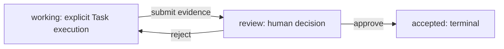

[English](p1-delivery.md) · [简体中文](../zh-CN/p1-delivery.md)

# P1: accepted business work

Implemented 2026-11-24. This is the bounded first slice from the
[dimension plan](board-dimensions.md) and [readiness review](board-readiness-review.md).
One trusted operator configures work, pins an existing Agent and target, executes
an explicit sequential SOP, submits immutable text evidence, and records a human
accept/reject decision. It does not yet plan or dispatch subsequent steps without
an explicit command.

## Product and authority contract

The default namespace is workspace `default`, with channel `general`. More named
channels can be created; there is no multi-tenant workspace selector. The shared
service key/session represents one trusted operator. `operator` and `runtime`
event authors distinguish input from observations, not separate authenticated
people. Independent worker credentials and independent reviewer guarantees remain
future work. An Agent must exist before a work item can be created.

A WorkItem owns one shared thread. Thread messages never dispatch by themselves.
Each execution stage creates one Task; known failure or review rejection can
produce a fresh explicit Task. The stage's original Run remains readable in its
own Agent Conversation. Parallel dependency DAGs and automatic planning are deferred.

## Records and invariants

SQLite schema v3 adds the following tables without discarding schema v1/v2 history.

| Table               | Key and relation                                             | Stored contract                                                                                            |
| ------------------- | ------------------------------------------------------------ | ---------------------------------------------------------------------------------------------------------- |
| `board_channels`    | Stable ID; unique normalized path                            | Default workspace channel and archive flag; max 100                                                        |
| `board_definitions` | Workflow ID + positive version                               | Immutable validated workflow and execution-state list; max 100 versions in the exposed catalog             |
| `board_work`        | Stable ID; references channel, Agent, exact workflow version | Title, goal, required criteria, business state, revision and timestamps                                    |
| `board_tasks`       | Stable ID; WorkItem; unique original `run_id`                | Stage, coordination status, revision, claim generation, expiry, private claim hash and linked conversation |
| `board_evidence`    | Stable ID; WorkItem + Task                                   | Immutable submitted Markdown, confirmed criteria, server-computed SHA-256 and timestamp                    |
| `board_events`      | Increasing cursor; WorkItem                                  | Append-only operator/runtime facts, safe metadata and review decisions                                     |
| `board_commands`    | Globally unique command ID                                   | Input fingerprint and private original receipt for idempotent replay                                       |

Dispatch intent reuses the Task-to-Run link plus the existing persisted Run request,
private target snapshot and checkpoint; P1 does not add a duplicate Dispatch table.
The claim check, linked Conversation, original Run and dispatch event commit in
one transaction before the engine starts observation. Nested operations use SQLite
savepoints. No synchronous SQLite transaction spans network I/O.

Command receipts can contain claim tokens. They are private data in the protected
SQLite file, never returned by list/detail/thread APIs. Browser claim tokens live
in the current tab's sessionStorage, separately from authentication cookies; CLI
claim receipts must be kept private. The service key is not stored in browser
storage. Revoking independently scoped clients is not a P1 capability.

## Workflow contract

A definition has `workflow` (the existing versioned definition) and
`executionStates`. IDs are stable machine values. Execution states are nonterminal
and have exactly one `submit` edge into a review state. Each review state has
`approve` and `reject` edges requiring approval. Approval reaches another execution
state or a terminal state; rejection reaches an execution state. All states must
be reachable. Limits are 32 states, 64 transitions and 16 execution states.

Default v1 is:



Custom multi-stage definitions can use collect → inspect → draft → review → accepted,
with the corresponding execution and review states. The API/CLI accepts these
structured definitions; a visual workflow editor is not included. Existing work
pins its exact definition version. New versions never silently change old work.

Evidence is the submitted Markdown text, not a fetched URL/file. The submitter
confirms every criterion; the human then reviews this exact content/digest and
records a nonempty decision note. External references and a digest do not establish
automatic content correctness. The review guard derives approval from the protected
review command; extra client fields such as `approved: true` are rejected.

## Coordination, execution and business state

| Action / observed fact       | Preconditions                                                                                                     | Durable result / rejection                                                             |
| ---------------------------- | ----------------------------------------------------------------------------------------------------------------- | -------------------------------------------------------------------------------------- |
| Create work                  | Active channel, existing Agent and workflow version, nonempty goal/criteria                                       | Initial business state + ready Task + thread event                                     |
| Claim                        | Current ready Task and expected Task revision                                                                     | Exclusive 120-second server-time lease, new generation and opaque token                |
| Renew                        | Same current, unexpired token and expected Task revision                                                          | Extend lease from server time; stale owner fails                                       |
| Release                      | Same current, unexpired token and expected Task revision                                                          | Ready Task; token invalidated                                                          |
| Expire before dispatch       | Claimed Task with no linked Run                                                                                   | Lazy reconciliation on detail/claim makes it ready; old generation cannot mutate       |
| Dispatch                     | Active channel, owned current claim, available capacity                                                           | Atomically persist Run intent/link/event; invalidate claim; then start observation     |
| Observe completed Run        | Original linked identity                                                                                          | Task completed; business state remains its execution stage                             |
| Observe failed/cancelled Run | Original linked identity                                                                                          | Task failed; explicit retry may create a new Task                                      |
| Observe unknown Run          | Missing terminal/restart/ambiguous admission                                                                      | Task unknown; new claim, evidence and replacement retry are blocked                    |
| Retry                        | Known failed current Task, expected WorkItem revision, active channel                                             | Fresh ready Task at the same business stage; original attempt retained                 |
| Submit                       | Current completed Task in current execution stage, exact criteria count/all confirmed, expected WorkItem revision | Immutable text evidence + `submit` workflow transition                                 |
| Approve / reject             | Current evidence ID, expected WorkItem revision, configured review edge, human note                               | Exact evidence decision recorded; advance or create correction-stage Task              |
| Post message                 | Existing WorkItem under operator authority                                                                        | Append context and increment revision; no automatic dispatch                           |
| Archive channel              | Existing channel                                                                                                  | Block new work, claims and dispatch; retain history, reviews and original-run controls |

Coordination is not Runtime status, and neither implies business acceptance. Claims
are not renewed after dispatch: the original Run identity becomes the authority
for observation. The current Task projection reconciles on detail/commands.

If the controller exits after intent commit but before observation, startup treats
the interrupted Run as unknown. If no checkpoint identity exists, it remains held
for investigation. There is no automatic fresh submission to “repair” it. Existing
Runtime recovery may reconnect to an original saved identity; cancellation
acknowledgement alone never establishes termination. P1 does not claim exactly-once
external side effects.

## API and error contract

Existing session/Bearer authentication and same-origin checks protect every route.
All mutation bodies require `commandId` (1–128 letters, digits, `_` or `-`). The
same ID and parsed input returns its original receipt, even after later state
changes; callers then read current detail. Reusing an ID with changed input returns
`409 IDEMPOTENCY_CONFLICT`. Clients retain the original ID/input after an uncertain
transport outcome. No automatic retry is performed by the server or SDK.

| Method/path                                               | Input / result                                                                                                             |
| --------------------------------------------------------- | -------------------------------------------------------------------------------------------------------------------------- |
| `GET /api/board?before=cursor`                            | Workspace, channels, definitions, newest 20 WorkItems and next cursor                                                      |
| `GET /api/board/attention?before=cursor`                  | Up to 20 business items awaiting review, independently of Runtime alerts                                                   |
| `POST /api/board/channels`                                | `{commandId, path}`                                                                                                        |
| `POST /api/board/channels/:id/archive`                    | `{commandId, archived}`                                                                                                    |
| `POST /api/board/definitions`                             | `{commandId, definition:{workflow, executionStates}}`                                                                      |
| `POST /api/board/work`                                    | `{commandId,title,goal,criteria,agentId,channelId,definitionId,definitionVersion}`                                         |
| `GET /api/board/work/:id?after=cursor&beforeTasks=cursor` | Current work/definition/task, 20 attempt records, latest 20 evidence submissions, 100 thread events and pagination cursors |
| `POST /api/board/work/:id/messages`                       | `{commandId,text}`                                                                                                         |
| `POST /api/board/tasks/:id/claim`                         | `{commandId,expectedRevision}` → `{task,claimToken}`                                                                       |
| `POST /api/board/tasks/:id/renew` or `/release`           | `{commandId,expectedRevision,claimToken}`                                                                                  |
| `POST /api/board/tasks/:id/dispatch`                      | Same claim body → original linked Task/Run, HTTP 202                                                                       |
| `POST /api/board/work/:id/retry`                          | `{commandId,expectedRevision}`                                                                                             |
| `POST /api/board/work/:id/evidence`                       | `{commandId,expectedRevision,taskId,content,checks:boolean[]}`                                                             |
| `POST /api/board/work/:id/review`                         | `{commandId,expectedRevision,evidenceId,decision:"approve"                                                                 | "reject",note}` |

Task claim/lease/dispatch revisions refer to the Task. Submit/review/retry revisions
refer to the WorkItem. Thread changes and reconciled Run outcomes advance the work
revision, so stale decisions fail. Inputs are strict and bounded. Typical errors
are `STALE_WORK_REVISION`, `CLAIM_LOST`, `TASK_NOT_READY`, `TASK_SUPERSEDED`,
`TASK_RETRY_NOT_ALLOWED`, `CHANNEL_ARCHIVED`, `EVIDENCE_NOT_ALLOWED`,
`CRITERIA_NOT_CONFIRMED`, `STALE_EVIDENCE`, `WORKFLOW_TRANSITION_NOT_ALLOWED` (409),
invalid schema (400), missing resource (404) and execution capacity (429).

The thread and attempt histories are paginated. Evidence shows the latest 20
submissions in P1; all remain stored. An older submission lookup/export API and
retention policy remain follow-up work.

## Web workflow

Open `/work` or choose **Work items**. Create a goal with one criterion per line,
select an Agent/channel/workflow, claim and start the current task. **Open execution**
uses the existing conversation UI for output, interactions, cancellation and
observation recovery. After Runtime completion, submit the actual deliverable text
and confirm each criterion. Human approval advances the configured business edge;
rejection creates a correction Task with the prior evidence and note in its bounded
execution context. **Needs attention** includes pending business reviews and
separately displays execution questions/failures.

English/Chinese, tab-session language preference, light/dark and mobile layouts
continue to apply. The browser polls work detail every five seconds; execution
continues without the page. Automatic step dispatch, trigger scheduling and
notifications are later work.

## Headless CLI and SDK

After `pnpm build`, use the same service origin and key through environment variables:

```sh
export ORCABOT_URL=http://127.0.0.1:4310
# Set ORCABOT_TOKEN privately in your shell or secret manager.
pnpm board list --json
pnpm board show WORK_ID --json
pnpm board create --input work.json --json
pnpm board claim TASK_ID --input claim.json --json
pnpm board dispatch TASK_ID --input dispatch.json --json
pnpm board submit WORK_ID --input evidence.json --json
pnpm board review WORK_ID --input review.json --json
```

Write commands read JSON from stdin or `--input file`, with the same fields as the
API. Examples in documentation use placeholder IDs; select real Agent IDs from
`/api/state` or the UI. `claim.json` contains `expectedRevision` and optionally a
stable `commandId`; `dispatch.json` also contains the private returned claim token
and updated Task revision. CLI mutation output is `{commandId,result}`; errors are
JSON on stdout with `--json` and a nonzero exit code. Preserve command IDs for retry. Neither
service keys nor claim tokens need to appear in command-line arguments.

Other verbs are `channel`, `archive`, `workflow`, `renew`, `release`, `retry` and
`message`; `--help` describes them. Reads support `list --before` and `show --after`.

The `orcabot-client` workspace package exports `BoardClient` and `BoardClientError`:

```ts
import { BoardClient } from "orcabot-client";

const client = new BoardClient({
  url: process.env.ORCABOT_URL ?? "http://127.0.0.1:4310",
  token: process.env.ORCABOT_TOKEN!,
});
const page = await client.list();
const work = await client.detail(page.items[0].id);
const commandId = crypto.randomUUID(); // Persist before a retryable command.
await client.command(
  `/board/tasks/${work.task.id}/claim`,
  {
    expectedRevision: work.task.revision,
  },
  commandId,
);
```

The SDK requires a caller-held command ID for writes and refuses credential-bearing
origins, non-Board paths and redirect responses. It does not provision scoped
credentials or automatically replay uncertain commands.

## Validation and remaining boundary

Automated HTTP/SQLite/SDK/CLI fixtures cover acceptance separate from Run completion,
claim races, lease generations, command replay/conflicts, archive protection,
transaction rollback on capacity rejection, custom stages, correction context,
stale evidence/reviews and restart quarantine. Existing original-identity recovery
and authentication tests continue to run. The implementation was mutation-tested
by allowing retry of unknown work: the restart regression failed, then the original
guard was restored and tests passed.

Browser testing uses a separate deterministic service and no paid provider calls.
Installed Runtime/provider readiness must be checked with real operator credentials.
The copied native service library is not installed as an OS service by this feature.
Scoped independent agents, memory systems, arbitrary dependency graphs, watchers,
external channels and automatic evidence checks remain outside P1.

The dedicated CLI now uses `orcabot board <command>`; `pnpm board` is its shortcut.
Use `--json` for machine-readable output. Errors use `{error:{code,...}}` on stdout
in JSON mode, following OctoRuntime conventions; text diagnostics use stderr.
See [CLI and deployment](cli-and-deployment.md).
